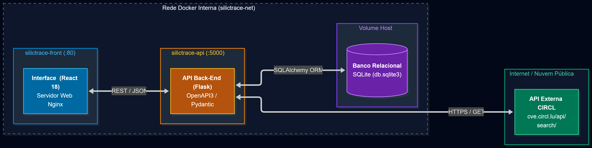

# ⚙️ SilicTrace | Back-end API (Python/Flask)

Bem-vindo ao repositório do **Back-end** do SilicTrace. Este microsserviço RESTful foi desenvolvido como Minimum Viable Product (MVP) para a Sprint de Desenvolvimento Back-end Avançado da PUC-Rio, implementado sob a topologia do **Cenário 1.1** (API REST própria que persiste dados relacionais, consome uma API externa pública em segundo plano e expõe contratos interativos OpenAPI/Swagger).

---

## O Projeto

A proposta central da API do SilicTrace é gerir a persistência de configurações de hardware de alta densidade (Workstations e Servidores) e orquestrar a auditoria contínua de segurança na camada física de silício. Diferente de sistemas tradicionais de cadastro patrimonial, o serviço valida parâmetros profundos de firmware e microcódigo, correlacionando-os a bases públicas globais de vulnerabilidades conhecidas (CVEs).

A aplicação foi desenhada para lidar de forma nativa com a heterogeneidade da computação corporativa, aplicando regras contextuais estritas conforme o ecossistema do processador:
* **Plataforma AMD:** Auditoria e validação de versões de encapsulamento **AGESA** (*AMD Generic Encapsulated Software Architecture*), como a vulnerabilidade *Zenbleed* / `CVE-2023-20593`.
* **Plataforma Intel:** Auditoria de revisões de microcódigo **MCU** (*Microcode Update*) e firmware **ME** (*Management Engine*), como a vulnerabilidade *Downfall* / `CVE-2022-40982`.

O serviço atua como uma barreira de integridade: valida estritamente todos os payloads de entrada via Pydantic v2, assegura a consistência relacional através do SQLAlchemy ORM com SQLite e provê um *fallback* para manter a resiliência caso o serviço externo remoto fique indisponível.

---

## Arquitetura da Aplicação (Cenário 1.1)

A solução organiza-se em camadas autônomas conteinerizadas com comunicação desacoplada via rede bridge:



1. **Front-End (`silictrace-front`):** SPA React 18 servida via Nginx Alpine na porta `80`.
2. **Back-End API (`silictrace-api`):** Serviço em Python/Flask na porta `5000` com documentação interativa Swagger/OpenAPI3.
3. **Persistência Local:** Base de dados SQLite montada via volume compartilhado no host.
4. **API Externa:** Consulta síncrona ao catálogo de segurança pública da CIRCL CVE Search.

---

## Tecnologias Utilizadas

* **Python 3.10:** Linguagem base de alto desempenho e tipagem estrita para o microsserviço.
* **Flask & Flask-OpenAPI3:** Framework web com geração nativa e automática de documentação Swagger 3.0.
* **SQLAlchemy ORM:** Mapeamento objeto-relacional com integridade referencial e suporte a relacionamentos 1:N.
* **SQLite:** Banco relacional leve e autocontido, persistido em disco via volume Docker.
* **Pydantic v2:** Validação, deserialização e tipagem estrita de schemas de entrada e saída.
* **Requests:** Cliente HTTP para comunicação e consumo da API externa da CIRCL.
* **Flask-CORS:** Gestão de cabeçalhos de segurança Cross-Origin Resource Sharing.
* **Docker:** Conteinerização baseada na distribuição leve `python:3.10-slim`.

---

## Modelo Relacional da Base de Dados

O banco de dados SQLite armazena as informações estruturadas em duas tabelas com integridade referencial e relacionamento **1:N (Um para Muitos)**:

```text
┌─────────────────────────────────┐          ┌─────────────────────────────────┐
│              Ativo              │          │          AuditoriaCVE           │
├─────────────────────────────────┤          ├─────────────────────────────────┤
│ id: Integer (PK)                │ 1      N │ id: Integer (PK)                │
│ tag_patrimonio: String(UQ)      ├──────────┤ ativo_id: Integer (FK)          │
│ categoria: String               │          │ cve_id: String                  │
│ fabricante: String (AMD/Intel)  │          │ descricao: String               │
│ cpu: String                     │          │ cvss_score: Float               │
│ gpu: String                     │          └─────────────────────────────────┘
│ memoria_ram: String             │
│ armazenamento_primario: String  │
│ versao_bios: String             │
│ versao_microcodigo: String      │
│ data_insercao: DateTime         │
└─────────────────────────────────┘
```

---

## Funcionalidades e Endpoints da API

A API implementa o ciclo CRUD completo com suporte aos 4 métodos fundamentais do protocolo HTTP:

| Método | Rota | Descrição |
| :--- | :--- | :--- |
| `GET` | `/ativos` | Lista todos os equipamentos e seus respectivos relatórios de CVEs vinculados. |
| `POST` | `/ativo` | Cadastra um ativo de hardware e dispara a auditoria externa síncrona. |
| `PUT` | `/ativo` | Atualiza versões de BIOS ou Microcódigo/AGESA pela tag de patrimônio. |
| `DELETE` | `/ativo` | Exclui um equipamento e remove os alertas vinculados. |
| `GET` | `/` | Redirecionamento para a interface Swagger interativa (`/openapi`). |

---

## API Externa Utilizada

* **Serviço:** [CIRCL CVE Search API](https://cve.circl.lu/)
* **Mantenedor:** Computer Incident Response Center Luxembourg (CIRCL)
* **Autenticação:** Gratuita e pública (não exige cadastro prévio nem chaves de API).
* **Licença:** Open Security Data / Creative Commons.
* **Rota Consumida:** `GET https://cve.circl.lu/api/search/{vendor}`
* **Tratamento:** O consumo é processado pelo backend intermediário sem redirecionar a navegação do usuário, retornando as falhas estruturadas e integradas diretamente aos cards da interface.

---

## Estrutura do Projeto

* `/models`: Modelos declarativos do SQLAlchemy com mapeamento relacional (`ativo.py`, `auditoria.py`).
* `/schemas`: Schemas de validação de dados Pydantic com tipagem rigorosa (`ativo.py`, `error.py`).
* `/services`: Módulo de integração e consumo da API externa da CIRCL (`circl_service.py`).
* `/database`: Diretório de persistência do banco relacional `db.sqlite3` montado via volume Docker.
* `/docs`: Armazena a imagem do diagrama de arquitetura do sistema (`arquitetura.png`).
* `app.py`: Ponto de entrada da aplicação, registro de rotas e inicialização do servidor Flask.
* `Dockerfile`: Instruções de empacotamento e inicialização do container Python.
* `requirements.txt`: Relação de dependências e bibliotecas do ecossistema Python.

---

## Como Executar Localmente

### Opção 1: Via Docker (Modo Isolado)

1. **Pré-requisito:** Certifique-se de que o **Docker** está em execução.
2. Acesse a pasta do back-end e construa a imagem:
```bash
docker build -t silictrace-api .
```
3. Execute o container mapeando a porta `5000` e o volume de banco de dados:
```bash
docker run -d -p 5000:5000 -v "${PWD}/database:/app/database" --name silictrace-container silictrace-api
```
4. Acesse a documentação interativa Swagger no seu navegador: http://localhost:5000/openapi

---

### Opção 2: Execução Direta no Ambiente Python (Desenvolvimento)

1. **Pré-requisito:** **Python 3.10** instalado no computador.
2. Crie e ative um ambiente virtual:
```bash
python -m venv env

# No Windows:
.\env\Scripts\activate

# No Linux/macOS:
source env/bin/activate
```
3. Instale as dependências do projeto:
```bash
pip install -r requirements.txt
```
4. Inicie o servidor:
```bash
python app.py
```
5. A API responderá em `http://localhost:5000` e a interface Swagger em `http://localhost:5000/openapi`.